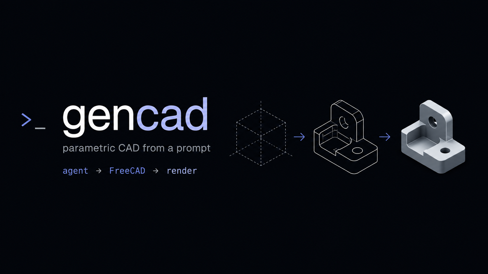

# gencad



**Parametric CAD from a prompt** — headless FreeCAD wired to a coding agent
over MCP, plus the render tooling that lets the agent *see* what it modeled.

An LLM can write solid FreeCAD Python, but generative CAD only converges when
the loop is closed: build the solid, render it, look at the render, fix the
script, repeat. gencad packages that loop:

```
agent ──(MCP)──▶ gencad server ──▶ freecadcmd (FreeCAD headless)
  ▲                                        │
  └──── section render PNGs ◀──────────────┘
```

## What's here

- **`server/gencad_mcp.py`** — a zero-dependency MCP server (stdlib only,
  stdio transport) exposing two tools:
  - `freecad_run` — execute a parametric build script inside `freecadcmd`
  - `freecad_render_section` — slice any solid in a `.FCStd` with a plane and
    render a filled cross-section PNG (material vs. void by containment
    parity), so hole patterns, wall thicknesses and debossed text can be
    visually verified before anything is printed
- **`tools/render_section.py`** — the renderer itself; also usable standalone
  inside `freecadcmd`
- **`tools/render_iso.py`** — shaded isometric renders: tessellates named
  solids from a `.FCStd` and paints them with matplotlib (lambert shading,
  global painter sort, back-face culling). Per-object `translate` offsets make
  exploded views a JSON edit. Driven by `$GENCAD_ISO_ARGS`, same pattern as
  the section renderer.
- **`pcbtools/`** — headless KiCad layout automation: dump a board to
  JSON, plan routes with a rasterized multi-layer A* gated by an
  independent clearance oracle, write only verified copper back, and
  loop against `kicad-cli` DRC until zero errors and zero unconnected.
  Closes the electrical half of the agent loop the way the render tools
  close the mechanical half: [pcbtools/README.md](pcbtools/README.md)
- **`text-to-cad/`** — vendored from
  [earthtojake/text-to-cad](https://github.com/earthtojake/text-to-cad)
  (release 0.7.21, MIT), which gencad builds on as its base: a library of
  agent skills for CAD, CAE and CAM — generation with STEP/STL/3MF export, a
  local CAD Viewer, DXF drawings, robot descriptions, G-code slicing, part
  sourcing, and more. How the vendoring, upstream sync, and local patches
  work: [docs/vendoring.md](docs/vendoring.md)
- **`scan2cad/`** — the scan side of the loop: a screen-reader-native
  describe-and-draft CLI. A phone-scanned mesh goes in; out come a
  plain-language geometry report, an editable build123d script with named,
  uncertainty-tagged dimensions, and STEP reference surfaces. The scan is the
  draft, the caliper is the truth. Own venv and own README:
  [scan2cad/](scan2cad/)
- **`chili3d/`** — a git submodule pointing at
  [xiangechen/chili3d](https://github.com/xiangechen/chili3d) (AGPL-3.0): a
  full browser CAD app on TypeScript + a WebAssembly OpenCascade — the same
  kernel FreeCAD uses, so an exported `.step` opens as the *same* B-rep. The
  human's eyes at the end of the loop, where the render tools are the
  agent's. Hosted at [chili3d.com](https://chili3d.com); pinned here for
  offline or version-stable use: [docs/chili3d.md](docs/chili3d.md)
- **`geofield-bracket/`** — a git submodule pointing at
  [connorkapoor/geofield-bracket](https://github.com/connorkapoor/geofield-bracket)
  (AGPL-3.0): give it a box and a load, get a solver-certified shelf bracket —
  an SE(3)-equivariant field model over a single latent encoding geometry,
  physics and manufacturability, with immersed FEA and a live 3D designer. It
  is the generative-design counterpart to gencad's scripted loop. Submodule,
  not vendored — how it is pinned and updated:
  [docs/geofield-bracket.md](docs/geofield-bracket.md)
- **`models/`** — example parts built with this loop. Each `build_*.py` writes
  its `.FCStd`/`.step` beside itself (outputs are gitignored, so run the
  script to regenerate them); `section_*.png` are sample section renders.
- **`scripts/`** — upkeep for the vendored `text-to-cad/` tree
  (`pull-text-to-cad.sh`, `apply-gencad-patches.sh`); see
  [docs/vendoring.md](docs/vendoring.md)

## Docs

- [docs/prompting.md](docs/prompting.md) — how to state a part so the loop converges
- [docs/vendoring.md](docs/vendoring.md) — how `text-to-cad/` is vendored, patched and synced
- [docs/pcb.md](docs/pcb.md) — pcb/Zener, the electrical side of the loop
- [docs/chili3d.md](docs/chili3d.md) — the browser CAD app for human inspection
- [docs/geofield-bracket.md](docs/geofield-bracket.md) — the generative bracket submodule
- [pcbtools/README.md](pcbtools/README.md) — headless KiCad layout automation
- [scan2cad/README.md](scan2cad/README.md) — mesh scan to editable CAD draft

## Setup

1. Install [FreeCAD](https://www.freecad.org) (the app bundles Python with
   numpy + matplotlib — no pip installs needed).
2. Register the server with your agent. For Claude Code, add to `.mcp.json`:

```json
{
  "mcpServers": {
    "gencad": {
      "command": "python3",
      "args": ["/path/to/gencad/server/gencad_mcp.py"]
    }
  }
}
```

If `freecadcmd` isn't at the macOS default path, set `GENCAD_FREECADCMD`.

### CAD Viewer

The vendored text-to-cad release ships its Viewer inside the `cadgen` wheel:
browser previews of STEP/STL/GLB/URDF and friends on port 3245. Install the
cadgen version that matches the vendored tree, turn telemetry off (cadgen 0.5+
sends usage stats by default), then launch:

```bash
uv venv --python 3.12 .venv-viewer
uv pip install --python .venv-viewer/bin/python "cadgen==$(cat text-to-cad/VERSION)"
.venv-viewer/bin/cadgen telemetry off
.venv-viewer/bin/cadgen viewer --host 127.0.0.1    # cadgen viewer stop to quit
```

Then open a model by absolute path, e.g.
`http://127.0.0.1:3245/?file=/Users/you/gencad/models/part.step`.
`CADGEN_TELEMETRY=0` or `DO_NOT_TRACK=1` also turns telemetry off for a single
process.

### chili3d

For a zero-install human inspection stop, open the exported `.step` in the
hosted app at [chili3d.com](https://chili3d.com) (New Document → Import). The
pinned `chili3d/` submodule, the local build and an agent-driven import recipe
are in [docs/chili3d.md](docs/chili3d.md).

### pcb / Zener — the electrical side

[diodeinc/pcb](https://github.com/diodeinc/pcb) (MIT) scripts the circuit
board the way gencad scripts the enclosure: Zener schematics are code that
`pcb build` validates headlessly and `pcb layout` turns into KiCad files. It
is an installed CLI with its own toolchain manager, not a submodule. Install,
quick start and command reference: [docs/pcb.md](docs/pcb.md).

## Driving it: prompting the loop

The tooling gives the agent hands and eyes; you still supply the intent. How to
state a part so it converges — confirming the toolchain before modelling,
describing the *use* rather than the object, bounding what the agent may decide,
reporting a bad render as an observation instead of "it's wrong", putting print
constraints in the first prompt, and demanding checks that describe use (can the
button actuate, does the plug seat) plus which conclusions still need a physical
test: [docs/prompting.md](docs/prompting.md).

## Built with this loop: the claude-pet case

The enclosure for [claude-pet](https://github.com/gurul/claude-pet) — an
ESP32-S3 desk buddy around the Freenove display board — is parametric FreeCAD
Python authored and iterated exactly this way; the scripts live in that repo's
[`case/`](https://github.com/gurul/claude-pet/tree/main/case) directory.


Details the build/render/inspect loop carried: PCB-seating bosses biased
0.3 mm short of the derived board plane for preload, blind Ø4.0 × 6.8 mm bores
for M3 heat-set inserts, front-entry countersunk screws riding D-trimmed guide
standoffs through the PCB holes, a WS2812 glow window with BOOT/RESET
pokeholes — and a 1.2 mm "gauge" plate carrying just the board's hole grid, so
the footprint gets test-printed and verified against the physical PCB before
committing to full shells.

## License

MIT
