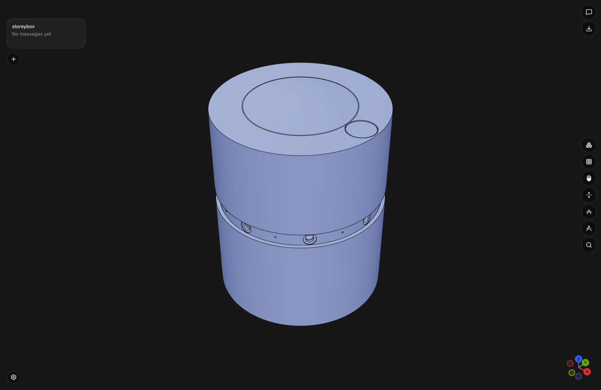

# Enclose as the project workbench

[Enclose](https://github.com/enclosedev/enclose) ([enclose.dev](https://enclose.dev))
is an open-source (AGPL-3.0) Electron app for working on a CAD model that a
script produces. It shows the model in 3D part by part; you pick a part, ask
for a change in plain words, and Claude Code — which the app runs in the
project folder through the Agent SDK — edits the script and builds it again.



*`models/storeybox.FCStd` after `scripts/enclose.sh project … --fcstd
models/storeybox.FCStd`, opened in Enclose (its headless `--capture` run).*

An Enclose project is a folder:

- `model.py` — a [build123d](https://build123d.readthedocs.io) script that
  builds the parts and hands them to Enclose's exporter, `enclose.py`, copied
  into the folder from the app's `kit/`
- `enclose.json` — where the manifest is and how to build:
  `{"model": "build/enclose.model.json", "build": "python3 model.py"}`
- `build/` — the build output: a `.glb` mesh, an `.edges.bin` and a `.step`
  per part, plus the `enclose.model.json` manifest that lists them; Enclose
  reads the model from that manifest and picks up a new one after each build

## Where it fits in the gencad loop

```
agent ──▶ freecadcmd build ──▶ .FCStd / .step
                                   │
             render_section / render_iso   (agent's eyes)
                                   │
                  enclose_project  (gencad → Enclose bridge)
                                   │
                  Enclose project  (human + Claude, part by part)
                                   │
                  Claude in Enclose ──(MCP)──▶ gencad server ──▶ freecadcmd
```

gencad's loop ends in a `.FCStd` or a `.step`. [chili3d](chili3d.md) is a
place to *look* at that result; Enclose is a place to keep *working* on it: a
per-part tree, click-to-select, and a Claude session that edits the project's
`model.py` and rebuilds. The bridge turns gencad output into an Enclose
project, and registers gencad's MCP server in that project so the Claude
running inside Enclose still has the FreeCAD tools.

## Submodule, not vendored

`enclose/` is a **git submodule** pointing at
[enclosedev/enclose](https://github.com/enclosedev/enclose), pinned at commit
`58a64e9`. Licensed AGPL-3.0 — see its bundled `LICENSE` and `NOTICE.md`.
Credit to the Enclose authors.

- **License separation.** gencad is MIT; Enclose is AGPL-3.0. A submodule
  keeps the two trees and their histories distinct. No Enclose source is
  copied into gencad's own files. The copies the bridge puts into *your*
  project (`enclose.py`, `screws.py`) stay AGPL-3.0, and `model.py` imports
  them: keep that in mind before you pass a scaffolded project on.
- **The kit is copied at run time, into your project.** Enclose's own
  projects carry a copy of `kit/enclose.py` in the project folder, plus
  `kit/screws.py` once the model has screws — that is how the app works. The
  bridge copies both up front, from the submodule into the project folder
  you name, never into gencad's tree.
- **No local patches.** It is consumed as-is, like
  [geofield-bracket](geofield-bracket.md) and [chili3d](chili3d.md). Contrast
  [vendoring.md](vendoring.md), where `text-to-cad/` *is* patched and so is
  copied in.

To see what upstream has done since the pin, `scripts/enclose.sh update`
fetches the submodule and lists the commits (`git -C enclose log --oneline
HEAD..origin/main`). It never moves the pin. To move it:

```bash
git -C enclose checkout origin/main
git add enclose && git commit -m "Bump enclose pin"
```

## Setup — `scripts/enclose.sh`

```bash
scripts/enclose.sh setup              # submodule + .venv-enclose with build123d
scripts/enclose.sh app [PROJECT]      # run the Enclose app from source
scripts/enclose.sh project ARGS...    # scaffold a project (the bridge CLI)
scripts/enclose.sh update             # fetch upstream, show what moved
```

- **`setup`** runs `git submodule update --init enclose`, then creates
  `.venv-enclose/` at the repo root (with `uv venv --python 3.12`; without uv
  it falls back to `python3.12 -m venv`, or `python3` when 3.12 is absent,
  plus pip) and installs build123d into it. It prints
  the venv's Python path. Safe to run again. `.venv-enclose/` is gitignored.
- **`app [PROJECT]`** checks for Node 22 or newer, runs `npm install` in
  `enclose/apps/desktop` if `node_modules` is missing, then
  `npm run dev -- PROJECT`, which opens the app with that folder added as a
  project. Without `PROJECT` it just opens the app.
- **`project ARGS...`** is `python3 tools/enclose_project.py ARGS...`, run
  from the directory you call it from, so relative paths in `ARGS` resolve
  there (the script finds the repo from its own location). When
  `.venv-enclose/bin/python` exists and you passed no `--build-python`, it
  adds `--build-python` with that venv's absolute path, so the project is
  built straight away (and `enclose.json` names that Python — see step 6
  below for what that ties the project to). `app PROJECT` likewise resolves
  a relative `PROJECT` from the calling directory.
- **`update`** — see above.

With no subcommand, or an unknown one, it prints usage.

The released app (a macOS disk image from
[GitHub Releases](https://github.com/enclosedev/enclose/releases/latest)) works
just as well as the source build: open the scaffolded folder from it.

## The bridge: `enclose_project`

One function, two front ends: the CLI `tools/enclose_project.py` (stdlib only)
and the MCP tool `enclose_project` on gencad's server, which imports it.

```bash
# from STEP files
python3 tools/enclose_project.py ~/Enclose/bracket --step models/bracket.step

# from a FreeCAD document, only two of its objects, built right away
python3 tools/enclose_project.py ~/Enclose/case \
    --fcstd models/case.FCStd --object Shell --object Lid \
    --name "Sensor case" --build-python .venv-enclose/bin/python
```

CLI flags: `OUT_DIR`, `--step F` (repeatable) or `--fcstd F` with optional
`--object NAME` (repeatable), `--name N`, `--build-python PY`, `--no-mcp`,
`--overwrite`.

The MCP tool takes the same things as JSON. Every input:

| Property | Type | Meaning |
|---|---|---|
| `out_dir` | string, **required** | Absolute path of the project folder. Created if missing. |
| `step_paths` | array of strings | STEP files to start from. Give this or `fcstd_path`, not both. |
| `fcstd_path` | string | A FreeCAD document to start from. It is exported to one STEP first (below). |
| `objects` | array of strings | With `fcstd_path` only: the objects to export, by Name or Label. Default: every visible solid-bearing Part feature or `App::Link` that no other visible one consumes (a boolean operand, a Body's feature); attachment references, a mirror's or Draft clone's source and a link's target do not count as consumed. |
| `name` | string | The model's title. Default: the input file's stem, title-cased. |
| `build_python` | string | A Python with build123d: an absolute path, or a bare name such as `python3.12` that is looked up on `PATH`. When given, the project is built now, the part labels are read back from the manifest, and this Python becomes the `build` command in `enclose.json`. |
| `with_mcp` | boolean, default `true` | Register gencad's MCP server in the project (see below). |
| `overwrite` | boolean, default `false` | Allow writing into a folder that already holds a `model.py` or `enclose.json`. This regenerates `model.py` from the template (see the caveat under "Claude inside Enclose"). |

What it does:

1. **Finds the kit.** The Enclose checkout is `enclose_root` (Python argument),
   else `$GENCAD_ENCLOSE_ROOT`, else `<repo>/enclose`. If `kit/enclose.py` or
   `kit/screws.py` is not there it stops and tells you to run
   `git submodule update --init enclose`.
2. **Refuses to clobber.** If `out_dir` already has `model.py` or
   `enclose.json`, it raises unless `overwrite` is set.
3. **Gets STEP into `source/`.** `step_paths` (`.step` or `.stp`) are
   copied into `out_dir/source/` under their own names; when two inputs share
   a basename the later one gets `-2`, `-3`, ... before the suffix
   (`part.step`, `part-2.step`) rather than overwriting. An input that already
   lives in `out_dir/source/` keeps its name and is never overwritten by
   another input. Every file the bridge writes replaces what is at that path,
   so a symlink already there is replaced, not followed. `fcstd_path` is
   exported by `freecadcmd` (resolved like the server's: `GENCAD_FREECADCMD`,
   the macOS app bundle path, then `PATH`) into one file,
   `source/<doc-stem>.step`, with each object a named body under its
   FreeCAD Label. `objects` entries are matched by object Name, then by
   Label. Without `objects` it takes the visible Part features and
   `App::Link` instances that have solids (a link is exported as the shape
   it shows, at the link's placement), and skips any that another of them
   holds through a link property — a boolean's `Base`/`Tool`, a compound's
   `Links`, a Body's features — so a cut tool does not show up as a part.
   Some links do not count: an expression that only reads another object's
   value, a hidden link (a PartDesign feature's link back to its Body), an
   attachment reference (`AttachmentSupport`, or `Support` in older
   documents — a boss attached to a plate leaves the plate a part of its
   own), the source of a copy (a `Part::Mirroring`'s `Source`, a Draft
   clone's `Objects`: the copy is a second body) and everything an
   `App::Link` points at (the target stays a part of its own). Any other
   object type, such as an `App::Part` container or a mesh, is not exported;
   naming one in `objects` is an error. The solids left out this way come
   back in `consumed_objects`, each with the objects that hold it. Use
   `objects` when the default picks the wrong set. Each object is exported
   where the document shows it: its placement and those of the `App::Part`
   containers it sits in are baked into the exported geometry, because
   FreeCAD's `Import.export` drops the placement of an object exported on its
   own. `freecadcmd` exits 0 even when a script raises, so the export
   counts as failed on a non-zero exit, on FreeCAD's `Exception while
   processing file` line, or when the script's success sentinel or the STEP
   file is missing. FreeCAD writes to a temporary file in `source/` that is
   moved onto `source/<doc-stem>.step` only after those checks pass, so a
   failed re-export (a mistyped `objects` entry with `overwrite`, say) leaves
   the project's existing STEP and files as they were.
4. **Copies the kit.** `enclose.py` and `screws.py` from
   `<enclose_root>/kit/` into `out_dir`.
5. **Writes `model.py`** — the `read_step` pattern from `enclose.py`'s
   docstring: a `Model(name)`, one group per `found.group`, one part per body
   in each STEP file this call put into `source/` (with its label, and its colour
   from the STEP unless every body shares one colour, in which case
   `read_step` drops it and the groups colour the parts). Files that were already in `source/` are not
   listed in `model.py`; the result names them in `unread_source_files`.
   A manifest already at `build/enclose.model.json` was built from some other
   `model.py`, so it is deleted (and named in `removed_manifest`) even when
   nothing is built: Enclose would otherwise show the old parts. Group ids are made unique in `model.py` itself, so group names
   that differ only in case or punctuation (`parts` from a file stem next to
   the default `Parts`) build as two groups instead of failing. A header
   comment says gencad scaffolded it and from what.
6. **Writes `enclose.json`** —
   `{"model": "build/enclose.model.json", "build": "<python> model.py"}`.
   `<python>` is `python3` unless `build_python` is given; a `build_python`
   inside `out_dir` (a project-local `.venv`) is written relative
   (`.venv/bin/python model.py`), one outside it as an absolute path. A bare
   name such as `python3.12` is looked up on `PATH` first. An absolute path
   ties the project to that interpreter: `scripts/enclose.sh project` writes
   this checkout's `.venv-enclose/bin/python`, so moving the folder to another
   machine, or deleting the venv, breaks the build command. Enclose's own
   convention is a command relative to the folder; for a project that has to
   travel, create a `.venv` inside it and pass that as `build_python`, or edit
   `build` in `enclose.json` afterwards.
7. **Writes `.gitignore`** with `build/` and `.venv/`, if there is none.
8. **Registers gencad's MCP server** when `with_mcp` is true (below).
9. **Builds**, when `build_python` is given: runs `<build_python> model.py`
   in `out_dir` (10-minute timeout). A failed build raises with the tail of
   its output and leaves the scaffolded files in place to fix. On success it
   reads `build/enclose.model.json` back.

Input errors — both inputs or neither, `objects` without `fcstd_path`, a
missing file, a `.mcp.json` that is not a JSON object — are caught before
anything is written. If scaffolding fails part-way in a folder the call
created, that folder is removed.

It returns `out_dir`, `source_files`, `files_written`, `built`, `parts` (the
part labels from the manifest, or `null` when not built), `manifest` (its
path, or `null`), `removed_manifest` (the path of an old manifest it deleted,
or `null`), `unread_source_files` (STEP files in `source/` that
`model.py` does not read) and `consumed_objects` (for an `fcstd_path` export
without `objects`: the visible solids left out because another one holds
them, as `{"label", "inside"}`; empty otherwise). The MCP tool reports a summary plus that dict as JSON. It
also requires every path it is given to be absolute (a bare `build_python`
name is not a path). Any failure comes back as a tool error with the
message, not a crashed server. The server resolves `freecadcmd`, and fails
when it is missing, only for `fcstd_path` input; for STEP input a missing
`freecadcmd` only means `GENCAD_FREECADCMD` is left out of `.mcp.json`.

## What a scaffolded project contains

```
out_dir/
├── source/<input>.step        the geometry, copied or exported
├── model.py                   read_step → Model → write()
├── enclose.py, screws.py      copied from enclose/kit/
├── enclose.json               manifest path + build command
├── .gitignore                 build/, .venv/
├── .mcp.json                  gencad's server        (with_mcp)
├── .claude/settings.json      pre-approves it        (with_mcp)
└── build/                     manifest, .glb, .edges.bin, .step per part (after a build)
```

Open it in Enclose (`scripts/enclose.sh app out_dir`, or drop the folder on
the window). It has an `enclose.json`, so Enclose opens it where it is rather
than copying it. Enclose does not run the build of a folder it did not
create, so if you scaffolded without `build_python`, nothing is in `build/`
yet: run the `build` command from `enclose.json` (it needs a Python with
build123d), or ask Claude in Enclose to set one up and build.

## Claude inside Enclose gets gencad's tools

Enclose runs Claude Code in the project folder with the user, project and
local setting sources, so project-scoped Claude Code configuration applies.
With `with_mcp` the bridge writes two files:

- **`.mcp.json`** registers the server `gencad`: command `python3`, args the
  absolute path to this repo's `server/gencad_mcp.py`, and
  `GENCAD_FREECADCMD` in its env when a `freecadcmd` could be found. It
  declares the server.
- **`.claude/settings.json`** sets `"enabledMcpjsonServers": ["gencad"]`,
  which approves that declared server. It is project settings, which
  Enclose's session reads, so it applies inside Enclose as well as in a plain
  `claude` session in the same folder (once you trust the folder there).

Keep both: `.mcp.json` says what the server is. `.claude/settings.json`
approves it ahead of time, which an interactive `claude` session in the
folder otherwise asks for before it starts a project server; where no
approval is asked for, it changes nothing.

Neither file decides whether a gencad tool *call* goes through. The gencad
tools are not among the ones Enclose allows outright, so each call follows
Claude Code's normal permission check under whichever access setting
Enclose is on: supervised and auto-accept-edits ask you first, auto asks
unless the call is routine, and full access never asks. A `permissions.allow` rule in your
own Claude Code settings applies too, since Enclose loads them.

If either file already exists it is merged — other servers and settings are
kept, and `gencad` is added to or replaced in them — rather than overwritten.
A file that is not a JSON object stops the bridge before it writes anything. `--no-mcp` / `with_mcp: false` skips both.

So a Claude session in Enclose can edit `model.py` in build123d *and* call
`freecad_run`, `freecad_render_section` and `enclose_project` against
FreeCAD — for example to re-run a gencad build script and write a fresh STEP.

To refresh the geometry of a project you have already edited, re-export only
the STEP file into `source/` (with `freecad_run`, or by hand) and rebuild.
Calling `enclose_project` on the same folder needs `overwrite`, and that
rewrites `model.py` from the template, which discards edits made to it. It
also leaves earlier files in `source/` in place; the new `model.py` lists
only the new inputs, and the summary names the files it leaves unread.

## Limits

- **macOS only.** The Enclose app supports macOS (13 or newer for the
  release); it has not been tried elsewhere. The bridge itself is plain
  Python and runs anywhere.
- **Node 22 or newer** to run the app from source (`scripts/enclose.sh app`).
- **build123d needed** to build a project. The bridge does not need it to
  scaffold; `scripts/enclose.sh setup` provides one in `.venv-enclose/`.
- **No FreeCAD colours.** A `fcstd_path` export goes through `freecadcmd`,
  which has no GUI view objects, so object colours are not written to the
  STEP. Without colours in the file, the parts are coloured by the group
  they are in.
- **A shape copied by value is a part of its own.** The default selection
  leaves out what another visible object *links* (a boolean's operands, a
  Body's features). A `Part::Feature` whose `Shape` a script assigned from
  other shapes — `models/build_storeybox.py`'s fused `Assembly`, kept for
  section renders — links nothing, so it is exported beside the parts it
  duplicates. Hide it in the document or name the parts with `objects`.
- **Claude Code must be installed and signed in** for Enclose to run Claude
  in the project.
- Enclose is early-days software; the gencad build script, or the project's
  `model.py`, stays the source of truth.
